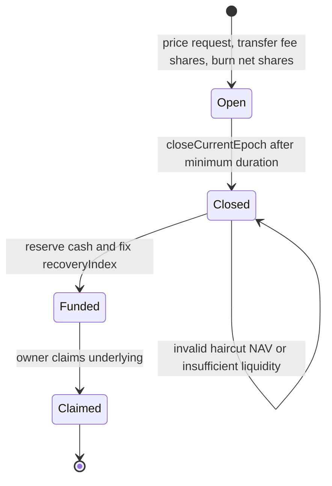

# Queue Mechanics

The queue implements economic exit at request in
`src/core/modules/EpochedQueueModule.sol`. Each request fixes an asset liability;
epochs group liquidity preparation and settlement. See [economic-exit.md](economic-exit.md)
for accounting policy and the [insolvency runbook](economic-exit.md#71-insolvency-governance-runbook).

## 1. Request lifecycle



`requestEpochWithdrawal(shares)` enforces the pause, fixed-maturity and deposit-lock
gates and rejects zero shares. It rolls the cap epoch before changes to assets or supply,
attempts a soft warm NAV refresh, and requires solvent, positive shareholder equity and
valid NAV. `_crystallizeExit` then:

1. Computes standard fee shares, rounded up, and net shares.
2. Prices `assetsOwed = convertToAssets(netShares)` before the burn, rounding down.
   A request rounding to zero assets is rejected.
3. Transfers fee shares from the user to `feeCollector` and burns net shares.
4. Increases `totalOwed` and records the immutable liability in the current Open epoch.

The user has economically exited immediately. Claims do not earn subsequent shareholder
returns and cannot be cancelled. There is no share escrow, close-time pricing, or claim-time
burn. The configured legacy claim floor and queue-depth dynamic cap do not govern this path.

## 2. Storage and counters

The current `EpochQueueStorage` namespace is documented in
[storage-layout.md §5](storage-layout.md#5-epochqueuestoragelayout--eip-7201-multyrstorageepochqueuev1).
The retired `QueueStorage` namespace remains reserved and unused.

| Record | Fields and meaning |
|---|---|
| `EpochClaim` | `user`, `requestedAt`, `claimed`, nominal `assetsOwed`, informational `grossShares` |
| `EpochData` | State and timestamps; gross/net/fee share totals; nominal `totalAssetsOwed` and `claimedAssets`; `claimCount`; `reservedRemaining`; immutable funded `recoveryIndex` |
| Global liabilities | `totalOwed`: nominal unfunded liabilities plus remaining funded reserves |
| Global cash earmark | `reservedForClaims`: sum of funded cohorts' remaining reserves |
| Global claim counter | `outstandingClaimCount`: all unclaimed claims, including Open and Closed epochs; decreases on claim, not close |
| Per-epoch counter | `claimCount`: submitted claims in that epoch; a new epoch starts at zero |
| Keeper cursor | `oldestUnfundedEpochId`: advances only past consecutively Funded epochs |

`outstandingClaimCount` remains the FixedMaturity Matured-to-Closed gate. It does not affect
instant cap enforcement. Claim IDs start at 1 independently for each epoch.

## 3. Close

`closeCurrentEpoch()` is permissionless, subject to the close/fund pause and fixed-maturity
settlement gates. It requires the minimum duration from `QueueParams.epochDuration`
(default one day when unset). It marks the current epoch Closed and opens the next one.
It does not price shares, transfer fees, burn shares or change `totalOwed`.

## 4. Fund

`fundEpoch(epochId)` is permissionless and subject to the close/fund breaker. An Open epoch
is rejected. An already Funded epoch is immutable: another call only attempts bounded
cursor repair and emits `EpochFundSkipped`.

For a Closed epoch, the target is its remaining nominal liability multiplied by the
unfunded-cohort ratio, rounding down:

```
freeAssets = max(grossAssets - reservedForClaims, 0)
unfundedOwed = max(totalOwed - reservedForClaims, 0)
ratio = unfundedOwed == 0 ? 1 : min(1, freeAssets / unfundedOwed)
```

When the initial target is below nominal, funding attempts a soft warm NAV refresh before
computing the target again and checking `navStatus()`. Stale warm NAV must pass the
15-minute freshness rule; a six-hour keeper cadence can therefore be repaired within the
funding transaction. A failed refresh does not permit an invalid-NAV haircut:
`EpochFundingNavInvalid` leaves the epoch Closed, without reserving or writing down claims.

Funding uses hot cash, then a best-effort warm refill and strategy redemption for the gap.
All other cohorts' reserves remain protected. After these external calls it recomputes the
target from current NAV and checks validity again when a haircut or liquidity shortfall is
present. A deficit larger than one underlying base unit leaves the epoch Closed and emits
`EpochFundingShortfall`. The one-unit funding tolerance applies only in insolvency and
never reserves more cash than exists.

On success it reserves the actual funded amount, sets `recoveryIndex` once to
`reservedRemaining * 1e18 / nominalUnclaimed`, writes the difference out of `totalOwed`,
and emits `EpochRecoveryCrystallized` and `EpochFunded`. Later recovery does not increase
this cohort's payout. An unhealthy strategy can leave it Closed indefinitely; governance
must follow the recovery-before-disable procedure in the insolvency runbook.

Funding out of order is supported. The bounded oldest-unfunded scan must not skip an
unfunded earlier epoch. `syncOldestUnfundedEpoch()` and repeated funding calls on an already
Funded epoch can advance a cursor that stopped at its scan bound.

## 5. Claim

`claimEpochAssets(epochId, claimId)` requires a Funded epoch, the claim owner as caller,
an unclaimed entry and an open funded-claim breaker. It pays
`floor(assetsOwed * epoch.recoveryIndex / 1e18)`, subject to the one-base-unit liquidity
rounding tolerance. It does not use the live global liability index to reprice the claim.

Accounting marks the claim before transfer, increments nominal `claimedAssets`, decrements
`outstandingClaimCount`, and releases its proportional share of this epoch's reserve from
both `reservedForClaims` and `totalOwed`. The last claim releases the entire remaining
cohort reserve. Per-claim payout rounding may leave unreserved asset dust; it does not leave
a fully drained cohort's earmark behind. Larger cash deficits revert, preserving the claim.

`batchClaimEpochAssets(epochId, claimIds)` processes the caller's unclaimed entries, skips
others and already-claimed entries, and transfers the aggregate. Failed token transfers
revert accounting changes. Manual owner claims remain available; this PR does not add the
automatic claim-settlement keeper proposed separately in #20.

## 6. Instant exits and separate cap epochs

`requestInstantWithdrawal` refreshes NAV before testing eligibility using gross share value.
It may refill warm liquidity. An eligible exit uses the instant fee tier, the shared
request-time pricing/burning helper, pays immediately and consumes the **net payout** from
the cap. An unavailable instant path queues at the standard fee tier and returns
`(false, epochId, claimId)`. The deposit lock applies to both paths; it cannot be bypassed
by forcing a queued fallback.

The cap epoch uses `CoreStorage.epochStart`, `epochDuration`, `epochWithdrawn` and
`capBaseSnapshot`; it is independent of settlement epochs. The cap is based on
`capPerEpochBps` and the shareholder NAV snapshot taken before asset/supply mutations.
Standard requests, closing, funding and claiming do not consume it. Legacy dynamic-cap
configuration has no effect. See [exit-engine.md](exit-engine.md).

## 7. Verification

`test/unit/core/EconomicExit_Spec.t.sol` and `EconomicExit_Gaps.t.sol` cover fixed liabilities,
share burns, fee tiers, lock enforcement, cap snapshots, reservations, immutable recovery
ratios, invalid-NAV deferral, stale refresh, and funding/claim rounding limits.
`test/fork/EconomicExit_ArbitrumFork.t.sol` checks integration against an archive RPC.
